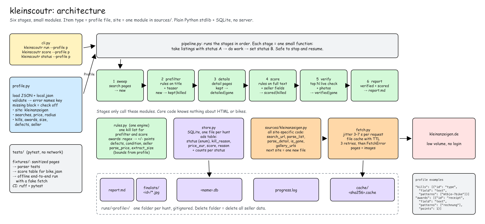

# kleinscoutr
Find the one good deal in thousands of classified ads.

kleinscoutr sweeps Kleinanzeigen (German classifieds), throws out everything that does not fit, scores the rest, and checks that the winners are still online. You describe the hunt in one JSON profile: what to search, the price range, what to reject, and what counts as a good sign.

- **Sweep:** all searches, all pages, deduplicated.
- **Filter:** hard kills on price, item type, size, and defects.
- **Score:** points for condition, brand, photos, receipt, and seller trust; penalties for defects and dealers.
- **Verify:** re-check the top picks live and download their photos.
- **Report:** a ranked Markdown table with the reason behind every score.

It grew out of a bike-hunter prototype, which ran a real hunt end to end: ~2900 listings swept, defect-scoring bugs found and fixed, winner picked.



<sub>Editable source: [`docs/architecture.excalidraw`](docs/architecture.excalidraw) (open in excalidraw.com or Obsidian).</sub>

## Requirements
Python 3.11+ and uv. The runtime uses only the Python standard library.

## Install
```sh
uv sync
```

## Quickstart
Set your location in `profiles/local.json`. This local file is ignored by Git. Its keys override the selected profile.

```json
{"location": "Berlin"}
```

Run all six stages:

```sh
uv run kleinscoutr run --profile profiles/bike.json
```

Paths are relative to the current working directory. Run commands from this checkout, or supply a profile path from your working directory. The local override is always read from `profiles/local.json` in that working directory.

## Commands
Each stage can run on its own. Use `--profile PATH` with any command.

| Command | Action | Extra flags |
|---|---|---|
| `run` | Run lists → prefilter → details → score → verify → report | `--fresh`, `--all`, `--top N` |
| `lists` | Sweep searches, follow pagination, deduplicate | `--fresh` |
| `prefilter` | Apply kills to title, teaser, and price | |
| `details` | Fetch kept listings that match the detail title filter | `--all` fetches all kept listings |
| `score` | Apply kills again, check required terms, assign points | |
| `verify` | Check the top candidates and download up to six images each | `--top N` |
| `report` | Write the ranked Markdown report | `--top N` |
| `status` | Print counts for all statuses, including an empty hunt | |

`--fresh` gives list pages a short cache TTL of 0.05 days (about 72 minutes). It does not fully bypass the cache. Normal list and detail cache TTL is seven days. Completed list pages are reused within that period. Verification of an unverified candidate always fetches its page with TTL zero.

Stages keep progress in SQLite. A second run reuses completed work. `--fresh` checks the list pages again. Existing ad IDs keep their state; verified and killed ads are not processed again. Failed detail fetches stay `kept`. Failed verification fetches or title mismatches stay `scored`, so the next verify command can retry them. A real deleted page becomes `gone`.

## Writing your own profile
Required keys:

| Key | Value |
|---|---|
| `name` | Directory name: letters, digits, `_`, or `-` |
| `site` | `"kleinanzeigen"` |
| `location`, `radius` | Location text and radius in kilometres |
| `price` | `[min, max]` in euros; unknown prices are not killed |
| `searches` | List of `{"kind":"keyword","q":"..."}` or `{"kind":"category","category_id":217}` |

A tiny profile:

```json
{
  "name": "desk",
  "site": "kleinanzeigen",
  "location": "Berlin",
  "radius": 10,
  "price": [0, 100],
  "searches": [{"kind": "keyword", "q": "Schreibtisch"}],
  "kills": [{"id": "broken", "field": "text", "patterns": ["kaputt"]}],
  "awards": [{"id": "wood", "field": "text", "patterns": ["Massivholz"], "points": 1}]
}
```

Optional checks are disabled when their block is absent. Patterns are case-insensitive regular expressions. Invalid patterns and wrong value types produce an error with the key name at load time.

| Optional key | Fields and behaviour |
|---|---|
| `max_pages`, `image_rule`, `report_top`, `verify_top` | Defaults: `25`, `"$_59.JPG"`, `20`, `20` |
| `detail_title_patterns` | Default `[]`; fetch tier-one details only for matching titles; `--all` skips this filter |
| `keep_patterns` | Default `[]`; at least one must match title + description at score time |
| `kills` | List of `{id, field: "title" or "text", patterns}`; the same list runs in prefilter and score |
| `size` | `patterns` with capture group 1, `recognition_range` (default `[40,80]`), `min`, `max`, `labels`, `labels_kill`, `points`; numbers outside the recognition range are unknown |
| `defects` | `patterns`, `penalty_per_distinct`, `penalty_cap`; repeated identical matches count once |
| `condition` | `patterns`, `min_distinct`, `points`; defects suppress condition points |
| `awards` | List of `{id, field: "text" or "seller_badges", patterns, points}`; optional `requires_patterns` requires an additional match; points can be negative |
| `photos` | `threshold`, `points`; award points when the image count exceeds the threshold |
| `seller` | `ads_threshold`, `ads_penalty`, `min_age_years`, `age_points`, `min_badges`, `badges_points`, `fresh_account_penalty` |

Awards use their IDs in reasons, for example `+1 brand (Fuji)` or `+1 two_brakes (beide bremsen)`. Defects use distinct matched text, for example `-4 defects (kaputt/platt)`.

The bike profile keeps its original weights. The unified kill list intentionally adds safety kills to prefilter and the `bodyguard` kill to score. Required terms run only at score time. Numeric prices are checked in both stages. Old database and profile formats are not supported.

## Output
All run output goes into `runs/<name>/`:

- `<name>.db`: SQLite listings with statuses `new`, `kept`, `killed`, `detailed`, `scored`, `verified`, and `gone`, plus `kill_reason` and integer `price_eur`.
- `cache/`: cached page and image bytes.
- `progress.log`: stage progress and fetch failures.
- `report.md`: scored and verified candidates, sorted by score descending, then numeric price ascending. Unknown prices sort first at equal scores.
- `finalists/manifest.json` and `finalists/<ad-id>/*.jpg`: verification results and downloaded images.

Verify reads candidates from the database. There is no `scored.json`. Delete the run directory when you want to start a new hunt or clear seller metadata.

## Development
```sh
uv sync --locked
uv run pytest
uv run ruff check .
```

Tests use sanitized excerpts from cached pages and fake fetches. They never access the network. The deleted-page fixture is hand-made because the cache contained no deleted listing. CI runs the same checks in one job.

## Known limitations
- Regexes do not understand negation. For example, `kein Defekt` can still match a defect rule.
- Site HTML can change and break parsing.
- Scores are hints. Check the full description, photos, and current online status before acting.
- An interrupted image download can leave incomplete photos for an online candidate. Inspect the manifest and log.

## Legal and terms of service
Private, personal use. Not affiliated with or endorsed by Kleinanzeigen. Automated access is against their ToS. Keep volume low. Requests use delays of 3–7 seconds and retries with waits. Never log in or try to bypass anti-bot measures. If blocked, stop. Treat seller metadata as temporary and delete the run directory after the hunt. Do not use this commercially without the commercial grant below.

## License
- Business Source License 1.1 ([LICENSE](LICENSE)) grants non-production use. The Change Date is 2031-09-21; conversion to Apache-2.0 takes effect on that date or the fourth anniversary of the first public distribution of a specific version, whichever comes first.
- Productive/commercial use is allowed under [COMMERCIAL-LICENSE.md](COMMERCIAL-LICENSE.md): 5% of revenue from or through use, reported and paid within 30 days of quarter end.
- No warranty and, to the extent permitted by law, no liability. The author has used this privately and never commercially.
